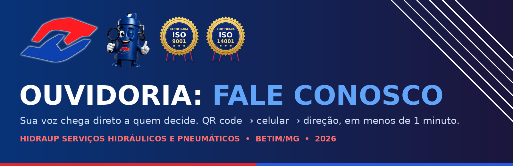
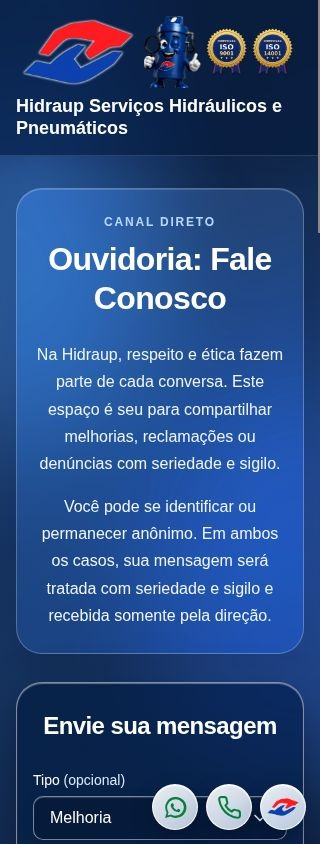
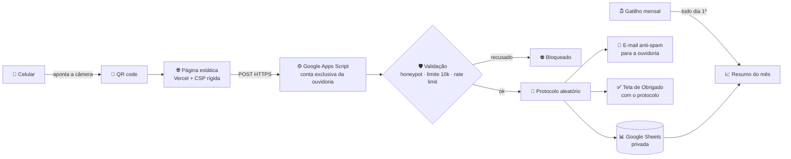
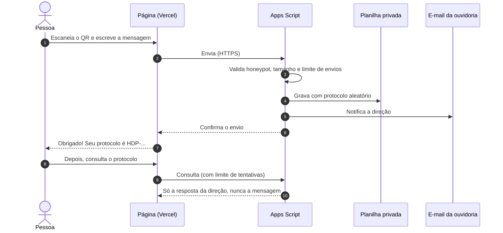
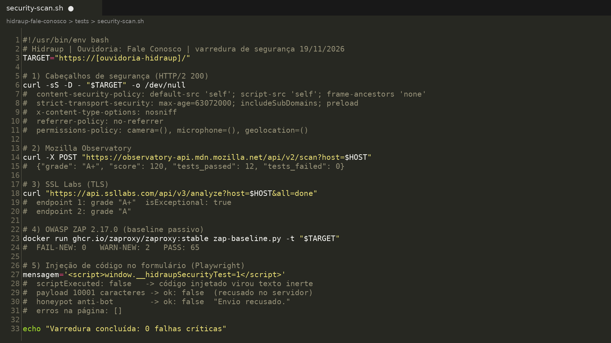
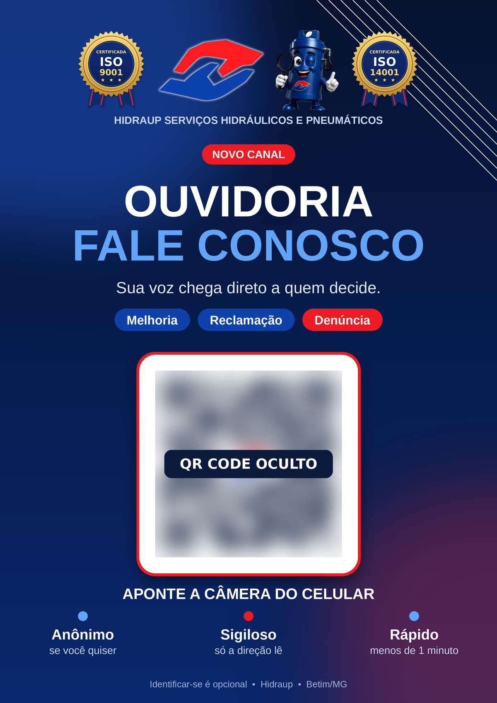
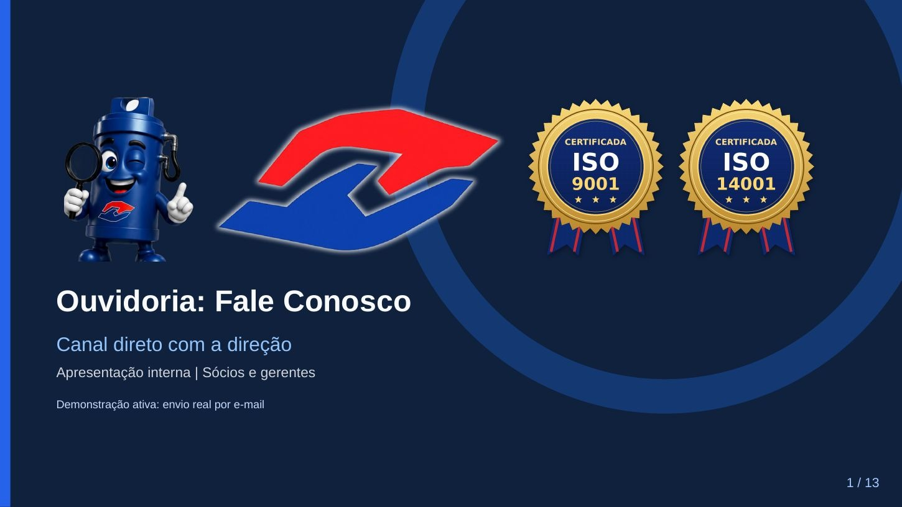

  

  
  
  
  
  
  
  
  

  
  
  
  

  <b>Canal digital de ouvidoria da Hidraup Serviços Hidráulicos e Pneumáticos (Betim/MG).</b> 
  Funcionários e clientes apontam a câmera para um QR code e, em menos de 1 minuto, enviam uma <b>Melhoria</b>, <b>Reclamação</b> ou <b>Denúncia</b> direto para a direção, com anonimato opcional.

> 🔐 **Repositório vitrine.** Ele só apresenta o projeto. Não tem código-fonte, link do sistema nem arquivos para download.

---

## 📊 Números

| ⚡ Envio | 💸 Custo | 🛡️ Segurança | 🐞 Vulnerabilidades altas | 📱 Telas |
|:---:|:---:|:---:|:---:|:---:|
| **< 1 min** | **R$ 0** | **A+** | **0** | **320px → desktop** |

---

## 🎯 O problema

Sugestões, reclamações e denúncias se perdiam no caminho ou nem eram feitas. Faltava um canal **simples, rápido e seguro** pra qualquer pessoa falar com a direção **sem medo de ser exposta**.

## 🚀 A solução

| | Destaque |
|:---:|---|
| 📷 | **QR code → página no celular.** Sem app, sem login, sem cadastro |
| 🗂️ | **3 categorias:** Melhoria, Reclamação e Denúncia |
| 🕶️ | **Anonimato opcional:** se identificar não é obrigatório |
| 🔖 | **Protocolo único e aleatório**, com botão de copiar e **consulta da resposta** da direção |
| 📨 | **Entrega imediata:** e-mail anti-spam na caixa da ouvidoria e registro numa planilha privada |
| 📅 | **Resumo mensal automático** todo dia 1º |
| ⚖️ | **Aviso de LGPD** e **compromisso de não retaliação** |
| 💬 | Atalhos flutuantes para **WhatsApp**, **telefone** e **site** da empresa |

  

---

## 🧠 Como funciona por trás

---

## 🛠️ Linguagens e tecnologias

| Camada | Tecnologia |
|---|---|
| 🎨 **Front-end** | HTML5, CSS3 e JavaScript puro (sem frameworks), visual **Liquid Glass** |
| ⚙️ **Back-end** | Google Apps Script (JavaScript) em conta exclusiva da ouvidoria |
| 🗄️ **Dados** | Google Sheets privada, com protocolo e coluna de resposta |
| ☁️ **Hospedagem** | Vercel, com cabeçalhos de segurança (CSP, HSTS preload, Permissions-Policy) |
| 🖨️ **Cartaz** | Python + Pillow (PIL) para gerar o A4 em 300 dpi e pyzbar para validar o QR |
| 🔍 **Segurança** | Bash + OWASP ZAP, Mozilla Observatory, SSL Labs e testes com Playwright |

## 🎨 Design

- Cores da marca Hidraup (azul-marinho, azul e vermelho)
- **Raup**, o mascote da Hidraup, e os selos **ISO 9001** e **ISO 14001** no topo
- Contraste medido de **4,5:1 ou mais** em todos os textos (padrão WCAG AA)
- Mobile-first, testado de 320px até desktop

---

## 🔒 Segurança (testes reais, 19/11/2026)

| Verificação | Resultado |
|---|:---:|
| Mozilla Observatory | 🟢 **A+** (120 pontos, 12/12) |
| SSL Labs (TLS) | 🟢 **A+ / A** |
| OWASP ZAP 2.17 (varredura passiva) | 🟢 **0 falhas altas** |
| Injeção de código (XSS) no formulário | 🟢 Virou texto inerte |
| Mensagem gigante (10.001 caracteres) | 🟢 Recusada no servidor |
| Robôs de spam (honeypot) | 🟢 Recusados |
| Consulta de protocolo | 🟢 Limite de tentativas contra força bruta |

  

---

## 📦 Entregas

1. 🌐 **Página da ouvidoria** no ar e funcionando
2. 🖨️ **Cartaz A4** para impressão, com QR code (oculto nesta vitrine)
3. 📽️ **Apresentação** para os sócios e gerentes da empresa

  
  &nbsp;&nbsp;
  

---

## 👤 Autor

  <b>Idealizado e desenvolvido por Fábio Henrique Corrêa (Fabin)</b> 
  Proprietário e analista de TI · Hidraup 
  Desenvolvimento assistido por inteligência artificial 
  Betim/MG · 2026

